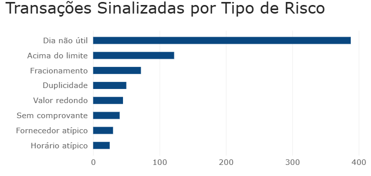
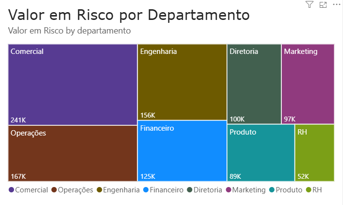

# 📊 Dashboard de Riscos em Despesas Corporativas

Projeto de análise de dados que identifica **transações de despesas com potencial de risco** (fraude, erro ou descumprimento de política) em uma base corporativa, combinando **Python + SQL** para a lógica de detecção e **Power BI** para a visualização executiva.

> Projeto de portfólio construído durante minha transição de carreira da auditoria contábil para a área de Dados. Ele une o que já fazia como auditora — avaliar risco, consistência e conformidade de informações financeiras — com as ferramentas de análise de dados que venho desenvolvendo.

---

## 🎯 O problema

Times financeiros processam milhares de reembolsos e gastos em cartão corporativo por mês. Revisar tudo manualmente é inviável, e os padrões de risco (duplicidade, fracionamento para driblar alçadas, gasto fora de política, ausência de comprovante) se perdem no volume. A proposta é **priorizar a revisão**: em vez de olhar tudo, olhar primeiro o que tem maior score de risco.

## 🧠 Como funciona (a lógica)

Cada transação passa por **8 regras de risco** inspiradas em testes reais de auditoria. Cada regra acende uma *flag*; o **score de risco** é a soma ponderada dessas flags, e a partir do score a transação é classificada em **Sem risco / Baixo / Médio / Alto**.

| Regra | O que detecta | Peso |
|---|---|---|
| Acima do limite | Valor acima do limite da política da categoria | 3 |
| Sem comprovante | Despesa relevante (> R$ 250) sem comprovante anexado | 3 |
| Fornecedor não homologado | Fornecedor fora da lista oficial | 3 |
| Possível duplicidade | Mesmo colaborador + fornecedor + valor em até 3 dias | 3 |
| Fracionamento | 3+ despesas no mesmo dia logo abaixo da alçada de aprovação | 2 |
| Dia não útil | Despesa em fim de semana ou feriado | 1 |
| Valor redondo | Múltiplo exato de R$ 500 a partir de R$ 900 | 1 |
| Horário atípico | Submissão entre 00h e 05h | 1 |

## 📈 Resultados (nesta base sintética)

- **2.143** transações analisadas · **R$ 2,80 mi** em despesas
- **28,8%** das transações sinalizadas com algum risco
- **R$ 1,03 mi (36,6%)** do valor total concentrado em transações de risco
- **49** transações classificadas como **risco Alto** — a fila prioritária de revisão




## 🔄 O fluxo do projeto (em etapas)

O projeto segue o caminho real de um trabalho de dados, e o repositório está organizado nessa ordem:

```
1. BASE BRUTA        →   2. LIMPEZA        →   3. ANÁLISE (Python)   →   4. DASHBOARD (Power BI)
   despesas_             despesas_             despesas_                 visualização e
   corporativas.csv      tratadas.csv          com_risco.csv             decisão
```

## 🗂️ Estrutura do repositório

```
dashboard-riscos-despesas/
├── data/
│   ├── despesas_corporativas.csv     # (1) base BRUTA, como sai do sistema
│   ├── despesas_tratadas.csv         # (2) base LIMPA, após tratamento
│   ├── despesas_com_risco.csv        # (3) base FINAL com flags e score → entra no Power BI
│   └── kpis_resumo.csv               # KPIs agregados
├── scripts/
│   ├── 00_gerar_base.py              # gera o dataset sintético (reprodutível, seed=42)
│   ├── 01_limpeza.py                 # trata a base: espaços, duplicatas, tipos, valores inválidos
│   └── 02_analise_risco.py           # aplica as regras, calcula o score e exporta os resultados
├── sql/
│   └── regras_risco.sql              # as mesmas regras de risco expressas em SQL
├── imagens/                          # gráficos da análise + prints do dashboard
├── GUIA_POWERBI.md                   # passo a passo para reconstruir o dashboard
├── DICIONARIO_DADOS.md               # descrição de cada campo
└── requirements.txt
```

## ▶️ Como reproduzir

```bash
# 1. instalar dependências
pip install -r requirements.txt

# 2. (opcional) gerar a base bruta sintética
python scripts/00_gerar_base.py

# 3. limpar e preparar a base
python scripts/01_limpeza.py

# 4. rodar a análise de risco (gera despesas_com_risco.csv, KPIs e gráficos)
python scripts/02_analise_risco.py
```

Depois, abra o **Power BI Desktop**, importe `data/despesas_com_risco.csv` e siga o [GUIA_POWERBI.md](GUIA_POWERBI.md) para montar o dashboard.

## 🔐 Sobre os dados

**Todos os dados são 100% sintéticos e fictícios**, gerados por script. Nenhuma informação real de cliente, empresa ou pessoa é utilizada — decisão consciente por se tratar de um domínio (auditoria/finanças) onde confidencialidade é obrigatória. Os padrões de risco foram inseridos propositalmente para tornar a detecção demonstrável.

## 🤖 Uso de IA neste projeto

Usei ferramentas de IA como **par de trabalho**, não como piloto automático — testando e validando cada saída antes de incorporar:

- **Estruturação do problema:** usei IA para brainstorm das regras de risco típicas de auditoria de despesas e refinei a lista com base na minha experiência prática.
- **Aceleração de código:** apoio na escrita das funções em pandas e na versão SQL das regras; revisei linha a linha, ajustei a lógica de duplicidade/fracionamento e conferi os resultados contra a base para garantir que as flags realmente batiam.
- **Documentação:** apoio na organização deste README e do guia do Power BI.

O julgamento sobre **quais** regras fazem sentido, **quais** pesos aplicar e se os números fecham foi meu — a IA acelerou a execução, não substituiu a análise crítica.

## 🛠️ Tecnologias

`Python` · `pandas` · `SQL` · `Power BI` · `matplotlib`

## 👤 Autora

**Emillyane Santos** — em transição para Análise de Dados.
📍 Recife, PE · [LinkedIn](https://www.linkedin.com/in/emillyane-santos-08693594)
